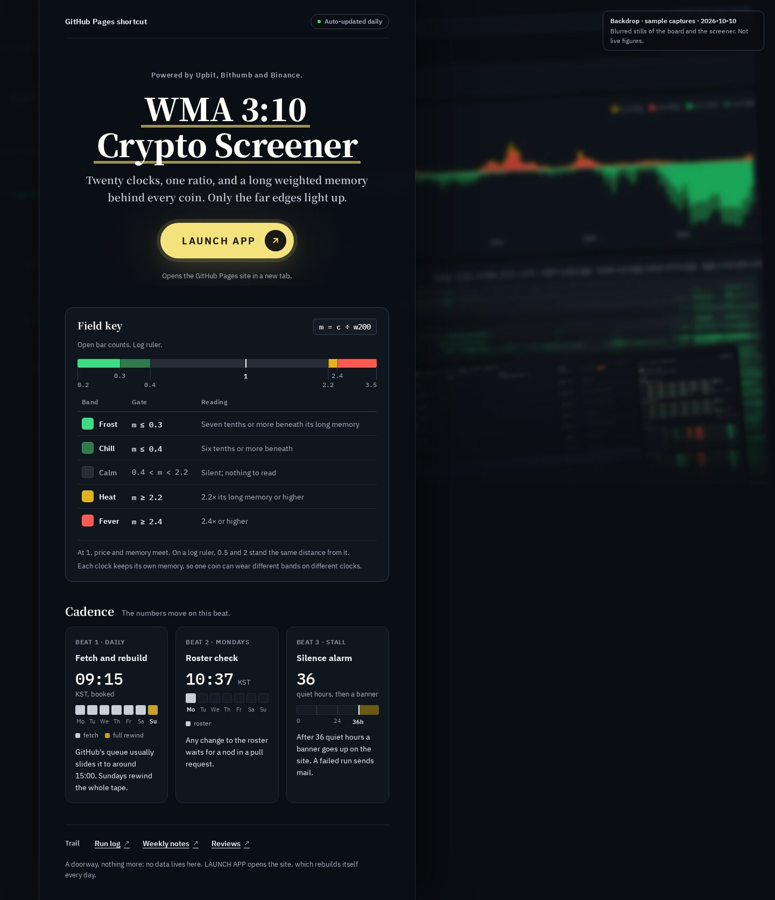
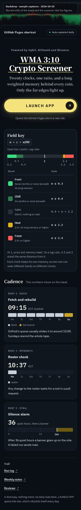

# 사이트 대문

이 문서는 바깥 사이트(예: GitHub Pages 사이트)를 여는 바로가기 화면을 Claude 아티팩트로 만들 때 따르는 화면 규칙을 정리합니다. 이 규칙은 2026년 10월 10일~11일(한국 시간)에 Claude가 'WMA 3:10 Crypto Screener' 대문을 다시 디자인한 작업에서 나왔고, Claude가 2026년 10월 13일에 이 문서로 정리했습니다. 이 문서의 날짜와 시각은 모두 한국 시간입니다. 사용자는 이 대문을 Claude 사이드바에 고정해 두고, 매일 갱신되는 GitHub Pages 사이트를 여는 데 씁니다. 사용자는 시안 여덟 개를 두 차례에 걸쳐 비교한 뒤, '판정형 패널'(시안 A)의 구성에 '다크 에디토리얼'(시안 B)의 다크 색상과 노란 알약형 단추를 가져오기로 했습니다(13절).

Claude는 사용자의 요청에 따라 대문의 모든 문구를 영어로 썼고, 그 가운데 일부는 영어 은어로 썼습니다. 은어를 쓰는 방법은 [../coded-copy/](../coded-copy/README.md)에 따로 정리했으며, 은어의 해설은 이 저장소에 두지 않습니다.

| 파일 | 내용 |
| --- | --- |
| [reference.html](reference.html) | 참조 구현입니다. 브라우저로 바로 열립니다. 원래 아티팩트는 https://claude.ai/artifact/H3Xryr2EQ3YYy9FFtqiBy7 (소유자만 열 수 있는 비공개 링크, 마지막 수정 2026-10-11)입니다. 화면의 배치, 스타일, 문구, 동작은 원래 아티팩트와 같습니다. 이 파일에서는 문서 뼈대(doctype, `lang`, 문자 인코딩, 화면 폭 설정)를 붙이고, 탭 제목을 '사이트 대문 · 참조 구현'으로 바꾸고, 스크립트의 배열 두 개에 이름(`BANDS`, `TICKS`)을 붙였습니다. 원래 코드의 주석과 이름 가운데 일부가 은어의 뜻을 드러내서, 코드 주석, 클래스 이름, id, 색 변수 이름을 은어의 뜻을 드러내지 않는 낱말로 바꿨습니다. 아티팩트를 게시할 때 덧붙는 짧은 기본 스타일(휴대폰 화면의 안전 영역 여백 등)은 넣지 않았습니다. |
| [board-shot.webp](board-shot.webp), [screener-shot.webp](screener-shot.webp) | 배경으로 쓰는 사이트 화면 캡처 두 장입니다. 2026년 10월 10일에 캡처했고, 폭은 2000px입니다. 원본에는 사이트의 글자가 또렷하게 찍혀 있어서, 파일을 열어도 글자가 읽히지 않도록 미리 흐리게 처리한 파일을 넣었습니다(ImageMagick `-blur 0x4`). 참조 구현은 이 파일에 CSS 필터로 흐림을 한 번 더 줍니다. 원본은 저장소에 넣지 않았습니다. |
| [preview-desktop.jpg](preview-desktop.jpg), [preview-mobile.jpg](preview-mobile.jpg) | 참조 구현을 폭 1440px와 390px로 렌더링한 화면입니다. |

## 1. 언제 쓰는가

- 아티팩트가 데이터를 직접 담지 않고, 바깥 사이트를 여는 바로가기 구실을 할 때 씁니다.
- 대문은 어느 사이트를 여는지(실행 단추)와 그 사이트의 숫자가 얼마나 자주 바뀌는지(상태 배지)를 한 화면에 보여 주고, 그 아래에 카드 네 장(구간 카드 한 장과 작은 카드 세 장)을 둡니다.
- 바로가기 단추만 두면 화면에 빈 곳이 많아서 허전해 보입니다. 그래서 눈금 막대, 요일 칸, 게이지 같은 작은 그림이 있는 카드로 빈 곳을 채웁니다.
- 대문에는 실시간 값을 넣지 않습니다. 값은 대문이 여는 사이트에서 읽습니다.

## 2. 구성

왼쪽에는 읽기 패널을 두고, 오른쪽에는 사이트 화면 캡처를 흐리게 처리해서 배경으로 씁니다. 패널 안의 구역은 위에서부터 다음 순서로 놓입니다.

1. **머리줄**: 왼쪽에 대문 이름('GitHub Pages shortcut', 14px 700)을, 오른쪽에 상태 배지(5절)를 두고, 아래에 1px 선을 긋습니다.
2. **첫 화면**: 모든 요소를 가운데에 맞춥니다. 윗줄, 제목, 소개 문장, 실행 단추(4절), 단추 아래의 안내 문장이 차례로 놓입니다(6절).
3. **구간 카드**: 눈금 막대와 구간 표가 있는 카드입니다(7절).
4. **작은 카드 세 장**: 카드마다 이름표, 제목, 큰 숫자, 그림, 설명을 둡니다(8절).
5. **꼬리말**: 이름표 하나와 링크 세 개, 안내 문장 하나를 둡니다(9절).

패널의 바탕은 `rgba(11, 15, 21, 0.94)`이고, `backdrop-filter: blur(16px) saturate(1.1)`을 주어 배경이 거의 비치지 않게 합니다. 폭 901px 이상에서는 패널 양옆에 1px `#222A35` 선을 긋고, 오른쪽에 `24px 0 80px rgba(0, 0, 0, 0.45)` 그림자를 둡니다. 패널 안의 구역 사이 간격은 40px입니다.

| 화면 폭 | 배치 |
| --- | --- |
| 1101px 이상 | 패널 폭은 700px이고, 왼쪽 여백은 `clamp(0px, 5vw, 72px)`입니다. 배경 캡처 두 장이 패널 오른쪽에 보이고, 배경 설명 상자는 화면 오른쪽 위에 고정됩니다. 작은 카드 세 장은 가로로 나란히 놓습니다. |
| 901~1100px | 패널 폭을 600px로 줄입니다. 작은 카드는 한 줄에 한 장씩 위아래로 쌓고, 카드 안을 두 칸으로 나눠서 제목과 큰 숫자를 왼쪽 칸에, 그림을 오른쪽 칸에 둡니다. |
| 561~900px | 패널을 가운데에 놓고(최대 폭 760px, 위쪽 모서리 16px), 화면 위에서 120px 아래부터 시작하게 합니다. 그래서 배경은 패널 위쪽의 띠로 보이고, 폭 761~900px에서는 패널 양옆에도 어두운 배경이 좁게 보입니다. 패널 양옆 선을 없애고, 위쪽에 1px `#343F50` 선과 `0 -20px 60px rgba(0, 0, 0, 0.5)` 그림자를 둡니다. 스크리너 캡처는 숨기고 보드 캡처만 쓰며, 배경 설명 상자는 위쪽 띠 안에 둡니다. |
| 560px 이하 | 패널 안쪽 여백을 `20px 20px 32px`로, 구역 사이 간격을 34px로, 첫 화면 요소 사이 간격을 14px로 줄이고, 실행 단추를 패널 폭에 맞춥니다. 구간 카드의 안쪽 여백은 `16px 14px 14px`로, 표 글자는 13px로 줄입니다. 구간 표의 'Reading' 열을 숨기고, 그 열의 내용을 구간 이름 아래에 작은 글자로 옮깁니다. 작은 카드 안의 요소는 두 칸으로 나누지 않고 위에서 아래로 한 열로 쌓습니다. 링크는 한 줄에 하나씩 높이 40px로 쌓습니다. |
| 360px 이하 | 제목 글자를 31px로 줄입니다. 제목은 줄바꿈하지 않는 두 부분 사이에서만 줄을 바꾸므로, 글자가 크면 뒷부분이 화면 밖으로 넘칩니다. 폭 320px에서 `clamp()`의 최솟값인 36px를 그대로 두면 제목이 약 14px 넘치고, 34px까지는 가로로 넘치지 않습니다. 31px는 제목 밑줄의 양옆 여백까지 패널의 본문 폭(280px) 안에 들어가는 크기입니다. |

화면 폭이 551~900px일 때는 패널이 화면 폭에 가깝게 넓어져서 제목이 한 줄에 들어가고, 그 밖의 폭에서는 제목이 두 줄로 나뉩니다. 이 범위와 12절의 간격은 스크롤 막대가 화면 폭을 차지하지 않는 브라우저에서 잰 값입니다.

## 3. 배경

사이트의 실제 화면 캡처 두 장을 씁니다. 보드 캡처(`board-shot.webp`)는 화면 전체에 깔고, 스크리너 캡처(`screener-shot.webp`)는 오른쪽 아래에 기울여 겹칩니다. 두 캡처 모두 숫자와 글자가 읽히지 않도록 흐리고 어둡게 처리합니다.

| 레이어 | 값 |
| --- | --- |
| 보드 캡처 | 레이어를 사방으로 5%씩 넓혀(`inset: -5%`, 가로세로 110%) 깔고, 그림 폭을 `150vw`로 키워 오른쪽 위(`right 7vw top 7vh`)에 맞춥니다. 그림을 −2.5도 기울이고, `blur(2.4px) brightness(0.72) saturate(1.2)`를 줍니다. |
| 스크리너 캡처 | 폭 44%로 오른쪽 3%, 아래 −14% 자리에 두고 −5도 기울입니다. `blur(3.4px) brightness(0.68) saturate(1.1)`, 모서리 6px, 그림자 `0 30px 80px rgba(0, 0, 0, 0.75)`를 주고, 가장자리에 불투명도 0.06인 흰 선을 1px 두릅니다. |
| 그늘 | 그라디언트 세 개를 겹칩니다. 첫째는 왼쪽에서 오른쪽으로 갈수록 불투명도가 0.92에서 0.55(45% 지점)를 거쳐 0(70% 지점)으로 낮아지는 그늘입니다. 둘째는 오른쪽 가운데(82% 42%)를 비워 두는 둥근 그늘이고, 셋째는 아래쪽 22%를 덮는 그늘입니다. 색은 모두 `#0A0D12`입니다. |

- 배경 레이어는 `position: fixed`이므로 화면을 내려도 제자리에 있습니다. 레이어에는 `pointer-events: none`과 `aria-hidden="true"`를 주고, 그림의 `alt`는 비웁니다.
- **배경 설명 상자(디자인 원칙 9)**: 오른쪽 위에 'Backdrop · sample captures · 2026-10-10'과 'Blurred stills of the board and the screener. Not live figures.'를 적은 작은 상자를 둡니다. 글자는 12px이고, 바탕은 `rgba(10, 13, 18, 0.86)`, 테두리는 1px `#343F50`, 모서리는 10px입니다.
- 상자의 최대 폭은 `min(300px, calc(100vw - 패널 왼쪽 여백 - 패널 폭 - 40px))`입니다. 따라서 폭 901px 이상에서는 상자가 패널과 겹치지 않습니다. 900px 이하에서는 상자를 위쪽 띠 안으로 옮기고, 띠의 폭에 맞춥니다.
- 900px 이하에서는 보드 캡처를 기울이지 않고, 그림 높이를 640px로 맞춰 `right -8px top -80px` 자리에 둡니다. 필터는 `blur(1.8px) brightness(0.8) saturate(1.2)`입니다. 그늘은 위에서 아래로 짙어지는 그라디언트 하나로 바꾸며, 불투명도는 맨 위가 0.15, 90px 지점이 0.25, 200px 지점이 0.9입니다.
- 캡처는 대문이 여는 사이트의 화면만 씁니다. 다른 회사 제품의 화면은 쓰지 않습니다(저장소의 공개 범위 규칙).
- **파일 자체도 흐리게 처리합니다**: CSS 필터만 쓰면 캡처 파일을 직접 열었을 때 글자가 그대로 읽힙니다. 그래서 저장소나 아티팩트에 올리는 캡처 파일도 미리 흐리게 처리합니다. 이 사례에서는 ImageMagick의 `-blur 0x4`로 처리했고, 원본에 견주어 대문 화면의 배경이 조금 더 뭉개지는 정도의 차이만 생겼습니다.
- **자료와 권리**: 이 사례의 캡처 두 장은 사용자의 사이트(공개 저장소 tlzkrh1029/wma0.3-screenshot의 GitHub Pages 사이트)를 2026년 10월 10일에 찍은 화면이며, 다른 회사 제품의 화면이나 로고는 들어 있지 않습니다. 캡처 속 숫자는 사이트가 TradingView와 CoinGecko의 데이터로 계산한 값이고, 사이트에는 CoinGecko 출처 표기가 있습니다.

## 4. 실행 단추

| 항목 | 값 |
| --- | --- |
| 모양 | 알약형(모서리 999px)이며, 높이 66px, 안쪽 여백 `0 14px 0 40px`입니다. 560px 이하에서는 높이 64px로 패널 폭을 채우고, 글자를 가운데에 둡니다. |
| 색 | 바탕은 `#F4E27C`, 글자는 `#1A1916`입니다. 명암비는 13.41:1입니다. |
| 글자 | 'LAUNCH APP'이며, IBM Plex Sans KR 18px 700, 자간 0.14em입니다. |
| 화살표 원 | 지름 40px, 바탕 `#1A1916`, 화살표 `#F4E27C`입니다. 화살표는 오른쪽 위를 가리키는 SVG(18px, 선 굵기 2.4)입니다. |
| 빛 번짐 | `0 0 0 7px rgba(244, 226, 124, 0.13)`과 `0 14px 40px rgba(244, 226, 124, 0.16)`을 겹칩니다. 첫 화면의 바탕에도 같은 노랑으로 불투명도 0.07인 둥근 빛을 깔아서, 시선이 단추 쪽으로 모이게 합니다. |
| 마우스를 올렸을 때 | 바탕이 `#F8EBA6`으로 밝아지고, 빛 번짐이 9px(불투명도 0.18)로 넓어지며, 그림자가 `0 16px 44px`(불투명도 0.22)로 커집니다. 화살표 원은 오른쪽 위로 2px 움직입니다. |
| 키보드 초점 | 단추에서 10px 떨어진 자리에 3px `#FFFDF8` 윤곽선을 그립니다. |
| 움직임 줄이기 설정 | `prefers-reduced-motion: reduce`이면 전환 효과와 화살표 이동을 끕니다. |

- 화면에서 노랑을 강하게 쓰는 곳은 이 단추 하나입니다. 제목의 밑줄에도 같은 노랑을 쓰지만, 밑줄은 불투명도 0.62로 얇게(제목 글줄 상자 높이의 6%, 58px 글자에서 약 5px) 긋습니다.
- 단추 아래에는 사이트가 새 탭에서 열린다는 안내 문장('Opens the GitHub Pages site in a new tab.', 13px)을 둡니다. 링크에는 `target="_blank"`와 `rel="noopener"`를 줍니다.

## 5. 상태 배지

- 머리줄 오른쪽에 'Auto-updated daily' 배지를 둡니다. 글자는 12px 600 `#A3ACBA`이고, 테두리는 1px `#343F50`, 모서리는 999px, 안쪽 여백은 `5px 12px`입니다. 글자 앞에는 지름 6px의 초록 점(`#3DDC84`)을 둡니다.
- 사용자는 사이트를 열지 않고 대문만 보고도 사이트의 숫자가 얼마나 자주 바뀌는지 알 수 있습니다. 사용자는 이 점을 편리하고 유용하다고 평가했습니다(2026-10-13).
- 배지는 고정 문구이며, 사이트가 실제로 갱신되었는지 확인하지 않습니다. 초록 점은 '사이트가 지금 정상적으로 작동하고 있음'이라는 뜻으로 읽히기 쉬우므로, 배지 문구는 실제 갱신 주기와 반드시 맞아야 합니다(디자인 원칙 1). 갱신이 멈췄다는 경고는 배지가 아니라 사이트가 보여 줘야 합니다.

## 6. 첫 화면의 글자

| 요소 | 값 |
| --- | --- |
| 윗줄 | 13px 600 `#A3ACBA`, 자간 0.06em입니다. 이 사례에서는 거래소 세 곳을 적었습니다('Powered by Upbit, Bithumb and Binance.'). |
| 제목 | Noto Serif KR 900, `clamp(36px, 4.8vw, 58px)`, 줄 간격 1.14, `#FFFDF8`, `text-wrap: balance`입니다. 제목을 줄바꿈하지 않는 두 부분(`span.nb`)으로 나눠서, 줄이 바뀌는 자리를 두 부분 사이로 고정합니다. |
| 제목 밑줄 | 제목 전체에 `linear-gradient(transparent 88%, rgba(244, 226, 124, 0.62) 88% 94%, transparent 94%)`를 깔고, 양옆에 6px 여백을 둡니다. 시안 A에서는 글자 아래쪽 절반에 굵은 노란 띠를 깔았는데, 이 띠가 다크 바탕에서 탁한 올리브색으로 보여서 얇은 밑줄로 바꿨습니다. |
| 소개 문장 | Noto Serif KR 600, `clamp(17px, 1.5vw, 19px)`, 줄 간격 1.7, `#C9CFD9`이며, 문장의 폭은 30em을 넘지 않습니다. |

## 7. 구간 카드

눈금 막대와 구간 표가 있는 카드입니다.

- **카드**: 바탕 `#10161E`, 테두리 1px `#343F50`, 모서리 14px, 안쪽 여백 `20px 22px 18px`입니다.
- **머리**: 왼쪽에 카드 제목(Noto Serif KR 18px 700)을, 오른쪽에 수식 칩(IBM Plex Mono 14px, 바탕 `#151C26`, 테두리 1px `#343F50`, 모서리 4px)을 둡니다. 그 아래에 한 줄 설명(13px)을 둡니다.
- **눈금 막대**: 높이 16px 막대에 0.2부터 3.5까지를 로그 눈금으로 놓습니다. 다섯 구간을 `#3DDC84`, `#2F7A4D`, `#262D37`, `#E0B318`, `#FF5A52`로 칠하고, 구간 사이에 어두운 선(1px)을 넣습니다. 눈금 1의 자리에는 2px `#FFFDF8` 선을 긋습니다.
- **눈금 숫자**: 가까운 숫자끼리 겹치지 않도록 숫자를 두 줄에 번갈아 놓고, 숫자마다 막대까지 1px 선을 긋습니다. 양 끝 숫자는 막대의 끝에 맞춥니다. 처음에는 0.2와 0.3을 같은 줄에 두었는데, 폭 320px에서 두 숫자가 붙어서 0.2를 아랫줄로 옮겼습니다.
- **구간 표**: 열은 'Band', 'Gate', 'Reading' 세 개입니다. 구간마다 22px 색 칩(모서리 5px)을 달고, 조건은 IBM Plex Mono 600으로 씁니다. 가운데 구간의 행은 회색 글자로 써서 덜 눈에 띄게 합니다. 표 아래에는 짧은 안내 문장 두 줄(12.5px)을 둡니다.
- **스크립트**: 막대와 눈금 숫자는 스크립트가 그립니다. 구간은 `BANDS` 배열(`[시작, 끝, 색 변수]`)로, 눈금 숫자는 `TICKS` 배열(`[값, 'up' 또는 'dn']`)로 정합니다. `LO`와 `HI`에는 막대 양 끝 값의 로그(`Math.log(0.2)`, `Math.log(3.5)`)가 들어 있습니다.

## 8. 작은 카드

세 장 모두 같은 틀을 씁니다. 이름표(12px 600 `#8D96A5`, 대문자, 자간 0.06em), 제목(IBM Plex Sans KR 15.5px 700), 큰 숫자(IBM Plex Mono 30px 500 `#FFFDF8`)와 단위(13px), 그림, 설명(13.5px)이 차례로 놓입니다.

- **요일 칸**(첫째·둘째 카드): 일곱 칸을 높이 18px, 모서리 3px로 그립니다. 표시하는 요일은 `#C9CFD9`(`on` 클래스), 따로 강조하는 요일은 `#C9A227`(`full` 클래스), 표시하지 않는 요일은 `#151C26` 바탕에 1px 테두리로 칠합니다. 칸 아래에 요일 이름을 적고, 그 아래에 9px 색 견본으로 된 범례를 둡니다.
- **게이지**(셋째 카드): 0부터 48까지(시간)를 높이 18px 막대로 그립니다. 앞 구간(0~36, 막대의 75%)에는 12마다 눈금선을 넣고, 끝 구간(36~48, `.tail`)은 `#6B5A12`로 칠한 뒤 시작점에 2px `#E6E9EF` 선을 긋습니다. 막대 아래에 0, 24, 36h를 적습니다.
- 카드의 시각은 한국 시간으로 적습니다. 예약 시각과 실제로 실행되는 시각이 다르면, 설명에 실제 시각을 함께 적습니다.

## 9. 꼬리말

- 이름표와 링크 세 개를 한 줄에 둡니다. 링크는 14px 600으로 쓰고 밑줄을 그으며, 뒤에 회색 '↗'를 붙입니다. 560px 이하에서는 링크를 한 줄에 하나씩, 높이 40px로 쌓습니다.
- 링크 줄 아래에는 대문에 데이터가 없고 실행 단추가 사이트를 연다는 안내 문장(12.5px)을 둡니다.

## 10. 색, 글꼴, 명암비

이 패턴은 artifact-design의 대시보드 대안 시안이 쓰는 베이지 스타일([HANDOFF.md 2절](../../HANDOFF.md))과 다른 다크 스타일을 씁니다. 사용자가 시안 B의 다크 색을 골랐습니다(2026-10-11). 배경 캡처가 사이트의 다크 테마 화면이어서, 다크 색을 쓰면 패널과 배경이 한 면처럼 보입니다. 페이지에는 라이트 모드용 규칙이 없으므로, 브라우저가 라이트 모드여도 같은 다크 화면이 보입니다. `color-scheme: dark`는 스크롤 막대처럼 브라우저가 그리는 부분도 다크로 맞춥니다.

| 구분 | 값 |
| --- | --- |
| 바탕 | 화면 `#0A0D12`, 패널 `rgba(11, 15, 21, 0.94)`, 카드 `#10161E`, 보조 면 `#151C26`입니다. |
| 선 | 일반 선 `#222A35`, 강한 선과 테두리 `#343F50`입니다. 두 색은 글자에 쓰지 않습니다. |
| 글자 | 제목 `#FFFDF8`, 본문 `#E6E9EF`, 소개 문장 `#C9CFD9`, 보조 `#A3ACBA`, 작은 이름표 `#8D96A5`, 배경 설명 상자 `#A3ACB9`(굵은 줄은 `#E6E9EF`)입니다. |
| 강조 | 노랑 `#F4E27C`(실행 단추), 마우스를 올렸을 때의 노랑 `#F8EBA6`, 금색 `#C9A227`(요일 칸), 게이지의 끝 구간 `#6B5A12`(`--tail`)입니다. |
| 구간 색 | `#3DDC84`, `#2F7A4D`, `#262D37`(가운데 구간), `#E0B318`, `#FF5A52`입니다. 상태 배지의 초록 점도 `#3DDC84`입니다. |
| 글꼴 | 본문, UI, 작은 카드의 제목은 IBM Plex Sans KR입니다. 첫 화면의 제목과 소개 문장, 섹션 제목(구간 카드의 제목 포함)은 Noto Serif KR이고, 숫자와 시각과 수식은 IBM Plex Mono입니다. 글꼴은 모두 Google Fonts에서 받습니다. |
| 모서리 | 알약형 단추와 배지 999px, 카드 14px, 배경 설명 상자 10px, 칩 4~5px, 막대와 칸 3px입니다. |

명암비는 패널 바탕을 `#0B0F15`로 보고 계산했습니다. 패널이 94% 불투명하므로, 아래의 배경이 밝아져도 이 값은 거의 바뀌지 않습니다. 배경 설명 상자는 86% 불투명해서 아래 배경의 영향을 조금 더 받지만, 배경이 밝은 회색일 때도 명암비는 6.5:1 이상입니다.

| 글자 | 바탕 | 명암비 |
| --- | --- | --- |
| 제목 `#FFFDF8` | 패널 | 18.89:1 |
| 본문 `#E6E9EF` | 카드 `#10161E` | 14.94:1 |
| 소개 문장 `#C9CFD9` | 패널 | 12.27:1 |
| 보조 `#A3ACBA` | 카드 | 7.93:1 |
| 작은 이름표 `#8D96A5` | 카드 | 6.09:1 |
| 단추 글자 `#1A1916` | 노랑 `#F4E27C` | 13.41:1 |
| 배경 설명 `#A3ACB9` | `#0A0D12` | 8.49:1 |

## 11. 새 대문에 적용하는 순서

1. 대문이 열 사이트의 주소를 정하고, 그 사이트의 갱신 주기와 사이트에서 읽는 값의 구간을 확인합니다.
2. 사이트 화면을 폭 2000px 안팎으로 두 장 캡처합니다. 한 장은 배경 전체에 깔 캡처이고, 다른 한 장은 그 위에 기울여 겹칠 캡처입니다. 캡처한 날짜를 적어 두고, 두 파일 모두 글자가 읽히지 않도록 미리 흐리게 처리해서 WebP로 저장합니다(예: `convert 원본.png -blur 0x4 -quality 80 board-shot.webp`).
3. `reference.html`을 복사한 뒤, `<title>`, 머리줄의 대문 이름, 윗줄, 제목, 소개 문장, 단추 아래의 안내 문장, 링크 주소(실행 단추와 꼬리말), 꼬리말의 안내 문장, 배경 설명 상자의 날짜와 둘째 줄을 바꿉니다.
4. 구간 카드에서 `BANDS`, `TICKS`, `LO`와 `HI`를 새 구간에 맞추고, 구간 표의 행을 고칩니다. 'Reading' 열의 문장은 행마다 두 번(`td.read`와 좁은 화면용 `span.zone-read`) 들어 있으므로 두 곳을 함께 고칩니다. 막대의 `aria-label`도 새 구간과 조건에 맞춥니다. 구간이 다섯 개가 아니면 색 변수(`--b1`~`--b5`)와 표의 행을 함께 늘리거나 줄입니다. 상태 배지의 초록 점(`.pill::before`)은 `--b1`을, 가운데 구간의 칩(`.chip.mid`)은 `--b3`을 CSS에서 직접 쓰므로, 색 변수를 바꿀 때 두 곳도 확인합니다.
5. 작은 카드의 시각과 요일 칸(`on`, `full` 클래스)을 바꾸고, 요일 칸과 게이지의 `aria-label`도 고칩니다. 게이지의 끝 구간이 시작되는 값이 36이 아니면 `.ok`의 폭(75%), `.tail`의 시작점, 막대 아래 숫자의 위치를 함께 바꿉니다. `.ok`의 눈금선 간격(`repeating-linear-gradient`의 33.333%)은 '눈금 간격 ÷ 앞 구간의 길이'로 다시 계산합니다.
6. 화면 문구를 어떻게 쓸지 정합니다. 은어를 쓰면 [../coded-copy/](../coded-copy/README.md)를 따르고, 그때는 artifact-design/AGENTS.md의 '화면 문구의 예외'에 따라 영어로 쓸 수 있습니다. 은어를 쓰지 않으면 디자인 원칙 2에 따라 한국어로 씁니다.
7. 아래 점검 목록에 따라 확인합니다.
8. 아티팩트로 게시할 때는 캡처 두 장을 페이지와 같은 위치의 파일로 함께 올립니다.

## 12. 점검 목록

- 폭 1440, 1280, 1101, 1100, 1024, 901, 900, 768, 561, 560, 390, 360, 320px에서 렌더링해서 가로 넘침, 겹침, 잘림, 스크립트 오류가 없는지 확인합니다(디자인 원칙 6). 2026년 10월 13일에 Claude가 참조 구현을 이 13가지 폭으로 렌더링해서, 네 가지 문제가 모두 없음을 확인했습니다.
- 모든 점검 폭에서 배경 캡처를 확대해 숫자와 글자가 읽히지 않는지 확인합니다(디자인 원칙 9). 900px 이하에서는 CSS 흐림이 1.8px로 줄어들므로 따로 봅니다. 캡처 파일 자체도 원래 크기로 열어서 글자가 읽히지 않는지 확인합니다.
- 폭 901px 이상에서 배경 설명 상자가 패널과 겹치지 않는지 봅니다. 2026년 10월 13일에 잰 값으로는 폭 901px에서 패널 오른쪽 끝(645px)과 상자 왼쪽 끝(665px) 사이가 20px로 가장 좁았습니다.
- 제목이 두 부분 사이에서만 줄을 바꾸는지, 폭 320px에서 넘치지 않는지 봅니다.
- 폭 320px에서 같은 줄의 눈금 숫자가 서로 겹치지 않는지 확인합니다.
- 실행 단추에 마우스를 올리고 키보드 초점을 옮겨서 모습이 바뀌는지 확인하고, 움직임 줄이기 설정에서 전환 효과가 꺼지는지 확인합니다.
- 브라우저를 라이트 모드로 두어도 다크 화면으로 보이는지 확인합니다.
- 상태 배지의 문구와 작은 카드의 숫자가 사실과 맞는지 확인합니다(디자인 원칙 1).
- 배경 설명 상자에 적은 캡처 날짜가 실제 캡처 날짜와 같은지 확인합니다(디자인 원칙 9).

## 13. 비교한 시안과 결정(2026-10-10~11)

기존 대문은 밝은 바탕의 한 칸짜리 페이지였습니다. 바로가기 단추, 사이트 주소, 바로가기 링크를 늘어놓은 줄, 종목 바로가기 입력란, 눈금 막대, 목록이 위에서 아래로 놓여 있었습니다. 사용자는 사이트 화면 캡처 두 장을 배경으로 써서 이 대문의 디자인을 개선해 달라고 했습니다.

| 차례 | 안 | 결정 |
| --- | --- | --- |
| 1차 | 1. 분할형: 왼쪽에 반투명 패널을 두고, 오른쪽에 캡처 두 장을 흐리게 기울여 겹친 페이지 | 채택 |
| 1차 | 2. 전폭 머리: 화면 폭 전체를 차지하는 머리 영역의 오른쪽에 보드 캡처의 그래프를 깐 페이지 | 고르지 않음 |
| 1차 | 3. 두 개의 문: 사이트의 탭 두 개를 캡처를 얹은 큰 카드 두 장으로 나란히 둔 페이지 | 고르지 않음 |
| 1차 | 4. 제품 소개형: 브라우저 틀 안에 캡처를 넣고 번호 핀으로 설명한 페이지 | 고르지 않음 |
| 2차 | A. 판정형 패널: 가운데 정렬 첫 화면, 눈금 막대와 표가 있는 카드, 작은 카드 세 장을 둔 베이지 패널 | 채택(구성) |
| 2차 | B. 다크 에디토리얼: 다크 패널, 노란 알약형 단추, 눈금 막대와 24시간 띠 | 채택(다크 색상과 노란 알약형 단추) |
| 2차 | C. 규칙 목록: 규칙 행과 배지를 늘어놓은 베이지 패널 | 고르지 않음 |
| 2차 | D. 계기판: 눈금이 패널을 세로로 가로지르고, 단추가 눈금 1의 자리에 걸린 베이지 패널 | 고르지 않음 |

- 1차에서 분할형을 고르면서 사용자는 단추 이름을 'LAUNCH APP'으로 바꾸고 단추를 패널 가운데로 옮기기로 했습니다. 단추 옆의 사이트 주소, 바로가기 링크를 늘어놓은 줄, 종목 바로가기 입력란은 빼기로 했습니다. 이어서 빈 공간이 허전해 보이지 않도록, design-studio와 artifact-design의 스타일을 참고해 개선하라고 했습니다.
- 2차 시안 네 개는 같은 기준(콘셉트, 첫 화면과 위계, 핵심 요소 표현, 사용자가 할 일 지원, 가독성, 완성도)으로 비교했습니다.
- A를 고른 뒤에 사용자는 B와 같은 다크 테마, 영어 문구, 외부인이 뜻을 알아채기 어려운 은어 문구를 요청했습니다(2026-10-11).
- 사용자는 제목 후보 여덟 개 가운데 Claude가 추천한 'WMA 3:10 Crypto Screener'를 골라 화면 제목과 탭 제목에 썼습니다(2026-10-11).
- 사용자는 2026년 10월 13일에 이 대문에서 인상적인 부분으로 여섯 가지를 꼽았습니다. 전체 디자인, 실행 단추, 상태 배지(갱신 주기를 바로 알 수 있어서 편리하고 유용함), 실행 단추 아래에 놓인 디자인 요소와 설명 문구, 은어 표현, 사이트 화면에서 따온 흐린 배경입니다.
- 비교한 시안은 저장소에 내보내지 않았습니다. 이유는 두 가지입니다. 첫째, 시안을 아티팩트로 게시하지 않고 대화 안에 렌더링한 화면으로만 비교했기 때문에, 내보낼 아티팩트 원본이 없습니다. 둘째, 시안에는 은어로 바꾸기 전의 평문이 들어 있어서, 시안이 은어의 해설 구실을 합니다([../coded-copy/](../coded-copy/README.md) 3절).
