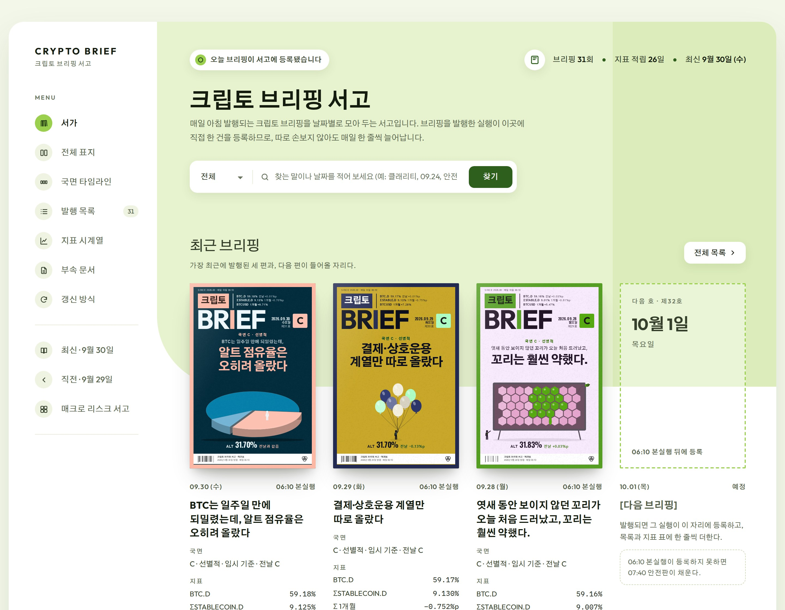
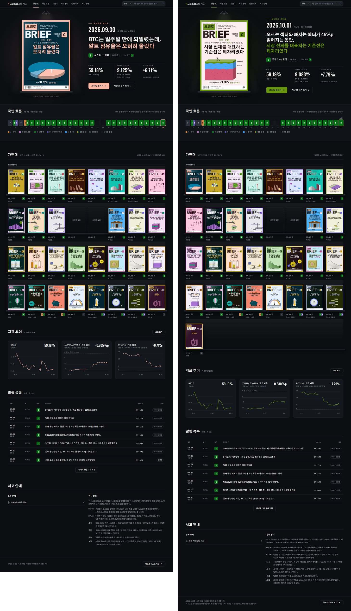

# 7. 서고 적용 이력

'크립토 브리핑 서고'(https://claude.ai/artifact/QnnPspYTfZKGGNSUpZsVNr)는 Claude 아티팩트로 게시된 웹 페이지입니다. 브리핑 기록은 페이지 안에 적혀 있지 않고, 아티팩트 데이터베이스의 `briefs`(브리핑)와 `related`(부속 문서) 컬렉션에 쌓입니다. 매일 06:10 본실행과 07:40 안전판이 그날 브리핑을 이 데이터베이스에 등록하면, 페이지가 그 기록으로 표지, 목록, 타임라인, 표를 계산합니다. 이 작업에서는 페이지를 세 번 바꿨고, 10월 16일에는 8번째 판에서 지난 호를 여는 방식을 한 번 고쳤습니다.

| 판 | 게시 시각(한국 시간) | 내용 | 파일 |
| --- | --- | --- | --- |
| 5번째 판 | 9월 30일 17:29 | 이 작업 전의 서고. 브리핑 한 편을 책 한 권으로 보고 책 표지를 그렸습니다. | `cover_design/page/src.html` |
| 6번째 판 | 9월 30일 23:00 | 표지를 잡지형 표지 모듈(시안 2)로 바꿨습니다. 페이지 구조는 그대로입니다. | `cover_design/page/final.html` |
| 7번째 판 | 10월 1일 12:29 | 페이지 전체를 밤의 가판대 테마(1차 실험의 YAML 결과)로 바꿨습니다. | 원본 사본 `iterations/2026-10-15_issue-viewer/base_src.html` |
| 8번째 판 | 10월 15일 14:44, 고친 판 10월 16일 01:01 | 가판대의 표지나 국면 흐름의 날짜 칸을 누르면 그 호가 열람 창으로 열립니다(시안 B). 긴 헤드라인이 첫 화면을 넘치던 결함도 고쳤습니다. 10월 16일에는 claude.ai 화면에서도 브리핑 대신 열람 창이 열리도록 표지와 날짜 칸을 버튼으로 바꿨습니다. | `cover_design/library_night/final.html` |

`page/src.html`과 `page/final.html`은 각각 게시된 5번째 판, 6번째 판과 바이트 단위까지 같습니다. 게시할 때 런타임 기능 선언(데이터베이스 읽기는 보는 사람 모두, 쓰기는 소유자만, 그리고 내려받기)은 바꾸지 않았습니다.

## 6번째 판: 잡지형 표지 적용

`cover_design/build_page.py`가 5번째 판 원본(`page/src.html`)을 다음과 같이 바꿔 `page/final.html`을 만들었습니다.

1. 책 표지 CSS와 JS 블록을 잡지 표지 모듈(`mz.css`, `mz.js`)로 바꿨습니다.
2. 표지가 쓰는 글꼴 굵기를 더하고, 책 표지만 쓰던 글꼴(Do Hyeon, Noto Serif KR, Bodoni Moda, Cormorant Garamond)을 뺐습니다.
3. 다음 호 자리 표시를 페이지의 산세리프 제목 글꼴과 연두색 점선 테두리로 바꿨습니다.
4. '권' 단위 문구를 '호'로 바꾸고, 표지 설명 문단을 잡지형 표지 규칙에 맞게 새로 썼습니다.
5. 표지가 페이지에 들어간 뒤, 달을 펼친 뒤, 검색한 뒤, 글꼴을 불러온 뒤에 `BK.fit()`이 표제 크기를 맞추도록 연결했습니다.

같은 스크립트가 만든 `page/preview.html`은 내려받은 글꼴과 `data.js`를 쓰고 시계를 9월 30일 21:15로 고정한 로컬 미리보기입니다.

## 7번째 판: 밤의 가판대 적용

### 요청

> yaml이 가장 나은데. 지금 시안에 나온 yaml의 컬럼 구성, 배치 딱 이대로 반영하자.

### 옮긴 것

1차 실험의 밤의 가판대 YAML 결과(`cover_design/experiment/night_yaml.src.html`)와 그 명세(`experiment/specs/night.yaml`)를 기준으로 삼았습니다.

- 구역 순서: 상단 막대 → 오늘의 호(히어로) → 국면 흐름 → 가판대 → 지표 추이 → 발행 목록 → 서고 안내 → 바닥글.
- 열 구성과 크기: 히어로의 표지 무대와 글 열, 가판대 한 줄 8칸(표지 143px), 지표 카드 3장, 발행 목록의 열.
- 토큰: 색(`--bg #0C0E12` 등), 글자 단계(`--ty-*`), 국면 색, 간격을 YAML 시안의 `:root` 그대로 옮겼습니다.
- 강조색: 최신 호 표지의 테두리 색(`pal(L).fr`)을 쓰고, `--s2`(#1A1F26)와의 명암비가 4.5 이상이 될 때까지 밝힙니다. 그래서 9월 30일에는 복숭아색, 10월 1일에는 연두색이 됩니다.

### 다시 연결한 실제 기능

실험 페이지는 고정된 데이터 사본으로 그린 그림이었으므로, 실제 서고에 있던 기능을 다시 연결했습니다.

- **데이터**: `claude.use('db')`로 `briefs`와 `related` 컬렉션을 구독하고(`onSnapshot`), 기록이 바뀌면 다시 그립니다. 값 정리(`normalize`)는 6번째 판의 것을 그대로 쓰고, 주소는 안전한 주소만 링크로 만듭니다.
- **CSV 내려받기**: `claude.use('downloads')`로 지표 표를 CSV로 저장합니다.
- **부속 문서**: 데이터베이스의 `related` 기록으로 목록을 그립니다.
- **알림 문구**: 바닥글에 "이 서고는 브리핑을 정리한 색인이며 투자 자문이 아닙니다." 문장을 남겼습니다.
- **실제 링크**: 브리핑 아티팩트 주소와 형제 서고(매크로 리스크 서고) 주소를 씁니다.
- **다음 호 문구**: 오늘 호가 이미 있으면 다음 날 '06:10 예정'을 보여 줍니다. 오늘 호가 아직 없으면 한국 시간에 따라 '06:10 예정'(06:10 전), '등록을 기다리는 중'(06:10~08:00), '아직 등록되지 않음'(08:00 이후)을 보여 줍니다.
- **가판대 접기**: 실제 오늘 날짜(한국 시간)를 기준으로 이번 달과 지난달은 펼쳐 두고, 그보다 오래된 달은 접은 채 '펼치기' 버튼을 둡니다.
- **검색과 펼치기**: 범위 선택과 입력, 결과 판, 발행 목록 펼치기, 표 보기, 국면 칸 툴팁을 동작하게 했습니다.

### 화면 폭 대응

YAML 시안은 폭 1440px 한 장으로 만든 그림이었으므로, 실제 페이지에서는 다음 규칙을 더했습니다.

| 화면 폭 | 처리 |
| --- | --- |
| 1440px 이상 | 시안과 같은 고정 배치(내용 폭 1312px) |
| 1280~1439px | 같은 배치를 CSS `zoom`으로 비율대로 줄입니다(`--z` = 폭 ÷ 1440). |
| 1280px 미만 | YAML 명세의 `mobile_390` 규칙을 따른 좁은 배치: 히어로를 세로로 쌓고, 국면 띠는 34px 칸으로 가로 스크롤하며, 가판대는 폭에 맞춰 한 줄 칸 수를 바꾸고, 카드는 세로로 쌓고, 목록은 두 줄 행으로 바꾸고, 메뉴와 검색은 펼침 판으로 엽니다. |
| 700px 미만 | 좌우 여백을 16px로 줄입니다. |

### 확인

`library_night/build.py`가 만든 로컬 미리보기(`preview.html`, 데이터베이스와 내려받기를 흉내 낸 가짜 `window.claude`, 10월 1일 12:30으로 고정한 시계)를 `library_night/shot.py`로 1440, 1300, 820, 390px 폭에서 캡처해 가로 넘침, 표지 헤드라인 넘침, 오류를 확인했습니다. 390px에서 가판대 빛 효과(`.slot .sglow`, 폭 160px) 때문에 생긴 9px 가로 넘침을 찾아 좁은 배치에서 폭을 칸에 맞추도록 고쳤고, 고친 뒤 화면 폭이 390px로 맞는 것을 확인했습니다.

| 캡처 | 파일 |
| --- | --- |
| 1440px 첫 화면 | `library_night/screenshots/lib_1440_top.jpg` |
| 1440px 전체 | `lib_1440.jpg`, 고친 뒤 `libfix_1440.jpg` |
| 1300px 전체(비율 축소) | `lib_1300.jpg` |
| 820px 전체(좁은 배치) | `lib_820.jpg`, 구역별로 나눈 `lib_820_cols.jpg` |
| 390px 전체(좁은 배치) | `lib_390.jpg`(고치기 전, 폭 399px), 고친 뒤 `libfix_390.jpg`, 구역별로 나눈 `lib_390_cols.jpg` |
| YAML 시안과 비교 | `cmp_lib.jpg` |

7번째 판은 10월 1일 12시 29분에 같은 주소로 게시되었습니다. 링크를 받은 사람도 바뀐 화면을 곧바로 보게 됩니다.

## 8번째 판: 지난 호 열람 창

### 요청

> (데스크탑 기준) 가판대 컬럼에서 지난 호를 클릭하면 바로 브리핑으로 넘어가네. 이러면 지난 호의 표지를 크게 볼 수가 없어. 클릭하면 바로 브리핑으로 넘기지 말고, 현 화면이 유지된 채 팝업 식으로 클릭 한 표지를 확대하여 보여줄 수 있을까? 팝업으로 확대 되었을때 화면 구성은 마치 '오늘의 호' 처럼 보여줬으면 좋겠어. 표지 확대해서 띄우고, 옆에는 주요 설명 몇 줄로 구성되게끔.

두 가지 배치(A: 오늘의 호 그대로, B: 전등 없이 표지 크게)를 시안으로 보이고 블라인드 평가를 받은 뒤, 사용자가 10월 15일 14시 35분에 "시안 b로 가자. 착수하자."라고 했습니다. 시안과 평가 기록은 [iterations/2026-10-15_issue-viewer/notes.md](../iterations/2026-10-15_issue-viewer/notes.md)에 있습니다.

### 바꾼 것

- **열람 창**: 가판대의 표지나 국면 흐름의 날짜 칸을 그냥 누르면 페이지를 그대로 둔 채 그 호가 어두운 막 위에 열립니다. 표지는 창 높이에 맞춰 폭 360~520px로 크게 보이고, 옆에는 첫 화면과 같은 항목(호수, 날짜와 실행, 헤드라인, 국면, 지표 3개, '브리핑 펼치기'와 '닫기')이 놓입니다. 강조색은 열어 본 호의 표지 테두리 색을 따릅니다.
- **닫기와 넘기기**: ×, Esc, 바깥 누르기로 닫고, 좌우 단추와 ←, → 키로 발행 순서에 따라 앞뒤 호를 넘깁니다. 브리핑은 열람 창 안의 '브리핑 펼치기' 단추나 큰 표지를 눌러서 엽니다. 10월 15일 게시본에서는 Ctrl·⌘·Shift를 누른 채 누르거나 가운데 단추로 누르면 새 탭에서 브리핑이 열렸지만, 10월 16일 고침에서 이 동작은 없어졌습니다.
- **좁은 화면(1280px 미만)**: 전체 화면 시트로 열리고, 위에 제목 줄, 아래에 이전 호, 브리핑 펼치기, 다음 호 단추가 늘 보입니다.
- **가판대 안내 문구**: '표지를 누르면 그 호를 크게 펼쳐 봅니다.'
- **긴 헤드라인**: 10월 15일 헤드라인(191자)이 36px로 10줄이 되어 데스크톱 첫 화면의 '오늘의 호'와 날짜가 위로, '브리핑 펼치기' 단추가 아래로 잘리던 결함을 고쳤습니다. 설명 단이 첫 화면 높이의 90%를 넘으면 헤드라인을 30, 26, 24px 순서로 줄이고, 그래도 넘치면 마지막 줄을 말줄임표로 자릅니다.
- 첫 화면, 국면 흐름, 지표, 발행 목록, 검색, 데이터베이스 구독, CSV 내려받기는 그대로입니다. 표지 모듈과 평가용 데이터 사본도 바꾸지 않았습니다.

`iterations/2026-10-15_issue-viewer/adopt.py`가 시험판의 원본에서 시안 A와 시안 전환 장치를 빼고 시안 B만 남겨 `library_night/src.html`을 만들었습니다.

### 확인

- `library_night/shot.py`로 `preview.html`(10월 1일 데이터 사본)을 1440, 1300, 820, 390px에서 캡처했습니다. 가로 넘침, 표지 표제 넘침, 콘솔 오류가 모두 없었습니다(`screenshots/v8_*.jpg`).
- 10월 15일 데이터 사본으로 만든 미리보기(`iterations/2026-10-15_issue-viewer/preview_adopted.html`)를 사용자가 고른 시안 B와 같은 조건(표지 질감의 난수 고정)에서 비교했습니다. 네 가지 창 크기, 긴 헤드라인, 두 번 발행한 날, 첫 화면에서 화소 단위까지 같았습니다.
- 같은 미리보기로 넘기기, Tab 순환, Esc와 바깥 누르기, Ctrl 누르기(10월 16일 고침 전의 동작), 날짜 칸에서 열기, 열린 채 창 크기 바꾸기를 확인했습니다.

### 게시

8번째 판은 10월 15일 14시 44분에 같은 주소로 게시되었습니다(아티팩트 버전 `1792043061-b6be`). 게시본의 제목은 사용자가 바꿔 둔 '📚 크립토 daily 브리핑 서고 ⭕'를 그대로 두었고, 런타임 기능 선언(데이터베이스 읽기는 보는 사람 모두, 쓰기는 소유자만, 그리고 내려받기)도 바꾸지 않았습니다. 게시 전에 실제 서고가 7번째 판과 제목만 다르다는 것을 확인했습니다.

### 10월 16일 고침: 표지와 날짜 칸을 버튼으로

10월 16일 0시 45분에 사용자가 "뭔가 문제가 있어? 아직 반영은 안된거같네"라고 했습니다. 실제 서고는 8번째 판을 내보내고 있었으므로, 페이지가 claude.ai 안에서 어떻게 실행되는지 다시 확인했습니다.

- **원인**: claude.ai는 아티팩트 페이지를 sandbox 속성이 붙은 틀(iframe) 안에서 실행하는데, 이 틀에는 페이지가 새 창을 열 수 있는 권한(`allow-popups`)이 없습니다. 그래서 링크 클릭은 claude.ai가 대신 처리합니다. 8번째 판의 가판대 표지와 날짜 칸은 브리핑 주소(`href`)를 가진 링크였고, 페이지가 클릭을 받아 이동을 막는(`preventDefault`) 방식이었습니다. 그래서 실제 화면에서는 페이지가 막기 전에 claude.ai가 브리핑을 먼저 열었을 가능성이 높습니다. 로컬 미리보기에는 claude.ai의 틀이 없어서 이 차이가 드러나지 않았습니다.
- **고친 것**: 가판대 표지(`.slot`)와 국면 흐름의 날짜 칸(`.tc`)에서 브리핑 주소를 뺐습니다. 두 요소는 이제 버튼 역할(`role="button"`)을 하며, 누르거나 Enter, Space 키를 누르면 열람 창이 열립니다. 브리핑은 열람 창 안의 '브리핑 펼치기' 단추와 큰 표지로 엽니다. 첫 화면의 표지와 단추, 발행 목록, 검색 결과는 예전처럼 브리핑으로 바로 연결됩니다. 주소가 없는 브리핑도 열람 창으로는 열립니다.
- **없어진 동작**: 가판대 표지나 날짜 칸을 Ctrl·⌘·Shift와 함께 누르거나 가운데 단추로 눌러서 브리핑을 새 탭으로 바로 여는 동작은 없어졌습니다.
- **확인**: `iterations/2026-10-15_issue-viewer/`에서 `python3 shot.py viewer adopted`로 확인했습니다. 표지와 날짜 칸 73개 가운데 링크 주소를 가진 것은 없었습니다. claude.ai처럼 링크 클릭을 페이지보다 먼저 받아 기록하는 장치를 넣고 눌러 보니, 표지 클릭은 링크로 처리되지 않았고 '브리핑 펼치기'만 링크로 처리되었습니다. 클릭과 Enter, Space로 열람 창이 열리는 것, 키로 열 때 페이지가 스크롤되지 않는 것, 닫으면 초점이 원래 칸으로 돌아오는 것, 국면 흐름에서 ←로 옮긴 뒤 Enter로 그날을 여는 것도 확인했습니다. `library_night/shot.py`의 네 폭 점검(1440, 1300, 820, 390px)에서도 가로 넘침, 표지 표제 넘침, 오류가 없었습니다.
- **게시**: 사용자가 "게시하고 PR에도 올리기"를 고른 뒤, 10월 16일 1시 1분에 같은 주소로 게시했습니다(아티팩트 버전 `1792080111-c793`). 제목과 런타임 기능 선언은 그대로 두었고, 게시본과 8번째 판 게시본의 차이가 위의 수정뿐임을 확인했습니다. 작업 환경의 브라우저는 claude.ai에 로그인되어 있지 않아서, 실제 claude.ai 화면에서 표지를 눌러 보는 확인은 사용자에게 부탁했습니다.

## 파일

| 파일 | 내용 |
| --- | --- |
| `cover_design/library_night/src.html` | 8번째 판 원본. `/*<<MZCSS>>*/`, `/*<<MZJS>>*/` 자리에 표지 모듈이 들어갑니다. |
| `cover_design/library_night/build.py` | `final.html`(게시본)과 `preview.html`(로컬 미리보기)을 만듭니다. |
| `cover_design/library_night/final.html` | 게시한 8번째 판(10월 16일 고침 포함). 게시할 때 제목만 '📚 크립토 daily 브리핑 서고 ⭕'로 바꿉니다. |
| `cover_design/library_night/preview.html` | 로컬 미리보기 |
| `cover_design/library_night/shot.py` | 여러 폭으로 캡처하고 넘침과 오류를 출력합니다(`python3 shot.py <접두어> 1440 820 390`). |
| `cover_design/library_night/db_snapshot.json` | 게시 직전에 읽은 데이터베이스 사본(브리핑 32건, 부속 문서 1건) |
| `cover_design/library_night/db/` | 같은 사본을 기록 하나에 파일 하나로 나눈 것 |
| `cover_design/library_night/screenshots/` | 확인용 캡처(8번째 판은 `v8_*.jpg`) |
| `iterations/2026-10-15_issue-viewer/` | 8번째 판의 시안, 확인, 평가, 반영 스크립트(`adopt.py`)와 7번째 판 원본 사본(`base_src.html`) |
| `cover_design/page/src.html`, `final.html`, `preview.html` | 5번째 판, 6번째 판, 6번째 판 미리보기 |
| `cover_design/build_page.py` | 6번째 판 빌드 스크립트 |
